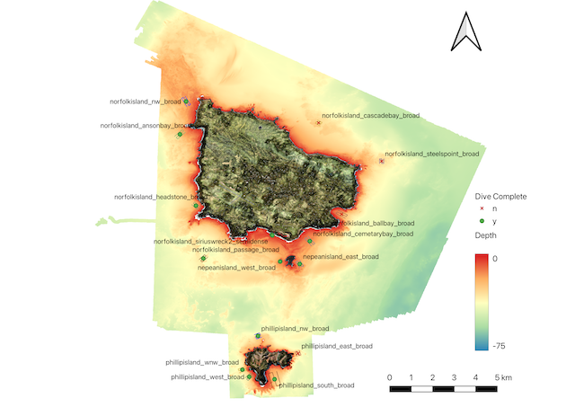

In May 2025, the team spent a week at Norfolk Island working closely with colleagues from [the Australian Museum](https://australian.museum/) and [the Auckland War Memorial Museum](https://aucklandmuseum.com) conducting AUV surveys around Norfolk and Phillip Islands.

This second phase of the Norfolk Island scientific expedition was led by the Australian Museum Research Institute (AMRI) in collaboration with the University of Sydney, Parks Australia, the Museum of New Zealand Te Papa Tongarewa and the Auckland War Memorial Museum, alongside the local Norfolk Island community. The expedition builds on the terrestrial survey undertaken by AMRI scientists in 2022–2023.

On this expedition, scientists undertook shore and vessel-based activities to collect fish and marine invertebrates, such as corals, crabs and molluscs, as well as algae, to expand knowledge of the marine environment. The focus of the AUV surveys was on selected reefs around Norfolk and Phillip Islands.

_Sites visited by the AUV, shown in green around Norfolk and Phillip Islands. Each AUV dive covered 1–3 km of transect, collecting detailed, high-resolution imagery of the seafloor. The bathymetric map, collected using LIDAR and acoustic data, was supplied by the Australian Hydrographic Office. AUV dives targeted particular seafloor features representing reefs around the islands at depths from 5–45 m._
